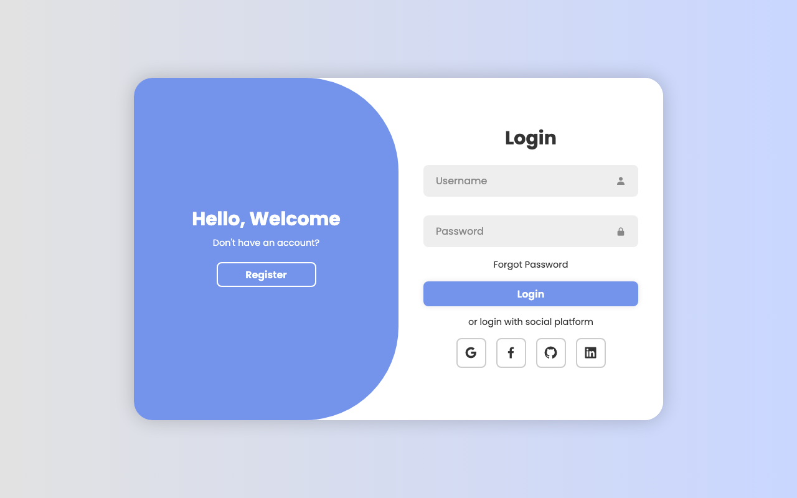
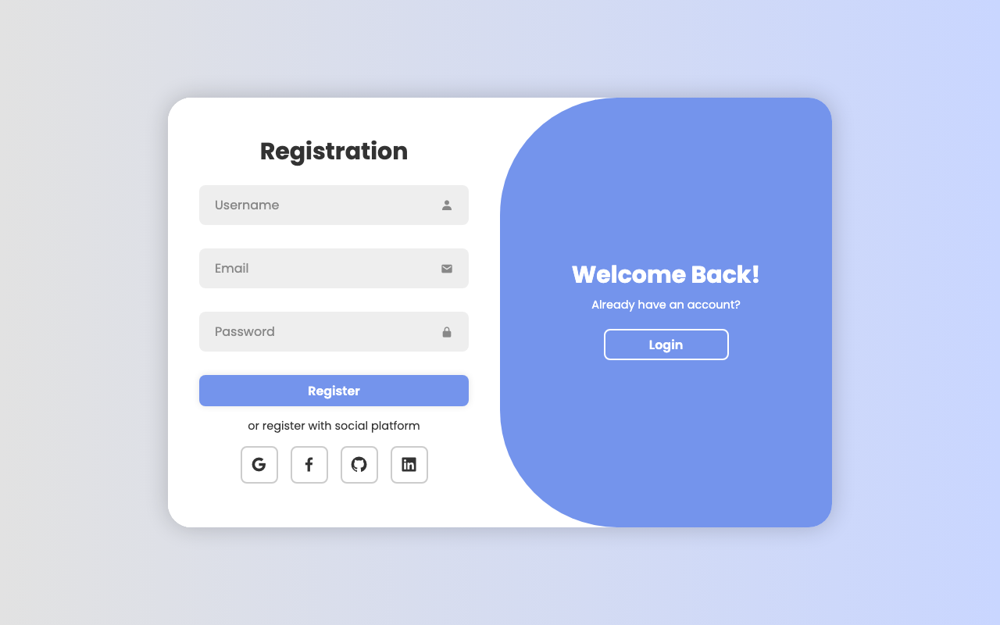

# 🔐 Responsive Login & Registration Page

A modern, responsive, and animated **Login and Registration Form** built with vanilla **HTML**, **CSS**, and **JavaScript**. Features smooth sliding transition animations between sign-in and sign-up states with custom styling and Boxicons.

---

## 📸 Preview

| Login View | Registration View |
| :---: | :---: |
|  |  |

---

## ✨ Features

- **Double Form Transition**: Seamless sliding animations toggling between the Login and Registration views.
- **Modern UI / UX**: Clean aesthetic with soft gradients, rounded corners, drop shadows, and responsive sizing.
- **Social Login Options**: Quick sign-in buttons for Google, Facebook, GitHub, and LinkedIn.
- **Icon-Enriched Inputs**: Input fields integrated with Boxicons (username, password, email).
- **Pure Vanilla Stack**: Zero external JavaScript frameworks or dependencies required.

---

## 🛠️ Built With

- **HTML5** - Page structure and semantic forms
- **CSS3** - Custom styling, flexbox layout, CSS transforms, and transition animations
- **JavaScript (Vanilla)** - Toggle logic for smooth state transitions
- **[Boxicons](https://boxicons.com/)** - Vector icons for input fields and social links
- **[Google Fonts (Poppins)](https://fonts.google.com/specimen/Poppins)** - Clean modern typography

---

## 📂 Project Structure

```
Login_page/
├── assets/
│   ├── login-preview.png     # Login page screenshot
│   └── register-preview.png  # Registration page screenshot
├── index.html                # Main HTML markup for login & register forms
├── style.css                 # CSS styles, transitions, and layout
├── script.js                 # JavaScript event listeners to toggle forms
├── LICENSE                   # MIT License
└── README.md                 # Project documentation
```

---

## 🚀 Getting Started

### 1. Clone the repository
```bash
git clone https://github.com/vinita8981/Login_page.git
cd Login_page
```

### 2. Run the project
Simply open `index.html` in your favorite web browser:
- Double click `index.html`, or
- Use VS Code extension **Live Server** (Right-click `index.html` -> "Open with Live Server").

---

## 👤 Author

- **Vinita** - [@vinita8981](https://github.com/vinita8981)

---

## 📄 License

This project is open source and available under the [MIT License](LICENSE).

